# 🍳 Cook It Yourself — Swiggy MCP Builders Club Proposal

> **From Craving to Cooking — An AI Agent that turns your restaurant cravings into homemade meals, powered by Swiggy's MCP Platform.**

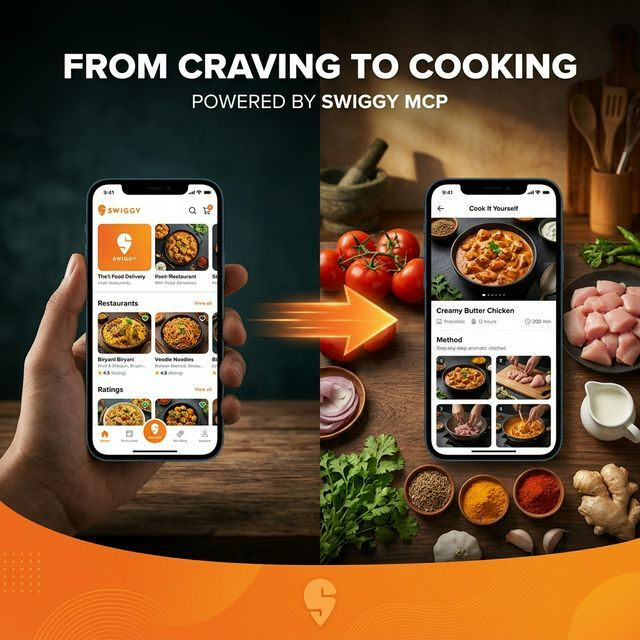

---

## 📋 Table of Contents

1. [Executive Summary](#executive-summary)
2. [Problem Statement](#problem-statement)
3. [Proposed Solution](#proposed-solution)
4. [User Journey & Workflow](#user-journey--workflow)
5. [System Architecture](#system-architecture)
6. [UI/UX Mockups](#uiux-mockups)
7. [Swiggy MCP API Integration](#swiggy-mcp-api-integration)
8. [Recipe Intelligence Engine](#recipe-intelligence-engine)
9. [Cost Savings Analysis](#cost-savings-analysis)
10. [Technical Requirements](#technical-requirements)
11. [Business Impact for Swiggy](#business-impact-for-swiggy)
12. [Roadmap & Milestones](#roadmap--milestones)
13. [Security & Compliance](#security--compliance)
14. [Team & Contact](#team--contact)

---

## 1. Executive Summary

**Cook It Yourself (CIY)** is an AI-native agent built on top of Swiggy's MCP platform that bridges the gap between **food craving** and **home cooking**. When a user searches for a dish (like Butter Chicken) on Swiggy, our agent intelligently suggests: *"Why not make it at home?"* — and then provides a complete recipe, maps every ingredient to available Instamart products, and auto-fills their Instamart cart in one tap.

| Attribute | Details |
|---|---|
| **Project Name** | Cook It Yourself (CIY) |
| **Category** | AI Agent / Consumer Tool |
| **MCP Servers Used** | Swiggy Food + Swiggy Instamart |
| **Primary Value** | Saves money, promotes healthy eating, increases Instamart GMV |
| **Target Users** | Health-conscious millennials, budget-aware families, cooking enthusiasts |
| **Submission Date** | April 27, 2026 |

---

## 2. Problem Statement

### The Guilt of Ordering Out

Every day, millions of Indians open Swiggy craving a specific dish. They browse restaurants, compare prices, and eventually place an order. But many of them feel a pang of **guilt** afterward:

- 💸 **Cost** — Restaurant food is 2-3x more expensive than home-cooked meals
- 🏥 **Health** — Restaurant food often uses excess oil, butter, and sodium
- ♻️ **Waste** — Single-use packaging and delivery carbon footprint
- 🍳 **Skill Gap** — Many want to cook but don't know the recipe or ingredients

### The Missed Opportunity

Swiggy already has all the pieces to solve this:
- **Swiggy Food API** — Knows exactly what dish the user is craving
- **Swiggy Instamart API** — Can deliver every ingredient in 10-15 minutes
- **AI/MCP Platform** — Powerful enough to connect these two intelligently

> [!IMPORTANT]
> The user's **intent** (craving a specific dish) is already captured in the Food search. CIY redirects that intent into a **higher-value Instamart order** while making the user feel good about their choice.

---

## 3. Proposed Solution

### Cook It Yourself — The Concept

An AI-powered agent that sits between Swiggy Food search and Swiggy Instamart, offering users a **"Cook It at Home"** alternative with:

1. **Smart Nudge** — A beautifully designed popup when searching for popular dishes
2. **Recipe Intelligence** — Full recipe with step-by-step instructions
3. **Ingredient Mapping** — Each recipe ingredient mapped to actual Instamart products
4. **One-Tap Cart** — All ingredients added to Instamart cart instantly
5. **Savings Calculator** — Real-time comparison: ordering out vs. cooking at home

### Key Features

| Feature | Description |
|---|---|
| 🔍 **Dish Detection** | AI identifies the searched dish and checks recipe availability |
| 💡 **Smart Popup** | Non-intrusive popup suggesting "Why not make it at home?" |
| 📖 **Recipe View** | Prep time, cook time, servings, step-by-step instructions |
| 🛒 **Ingredient-to-Cart** | Maps recipe ingredients → Instamart SKUs → adds to cart |
| 💰 **Savings Badge** | Shows how much the user saves by cooking at home |
| 🔄 **Serving Adjuster** | Scale recipe up/down, quantities auto-adjust |
| ❤️ **Favorites** | Save recipes for later, build a personal cookbook |
| 🎯 **Dietary Filters** | Filter by Veg/Non-veg, Low-calorie, High-protein, Keto |

---

## 4. User Journey & Workflow

### End-to-End User Flow

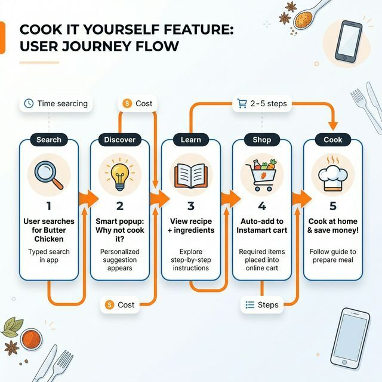

### Step-by-Step Walkthrough

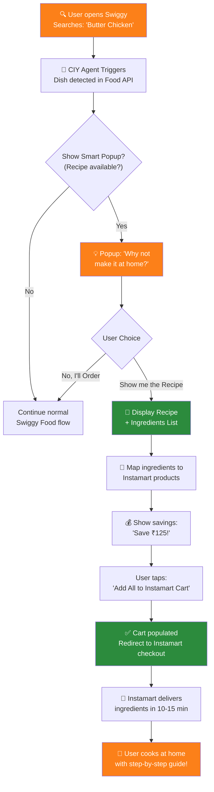

### Detailed Flow Description

| Step | Action | MCP API Used | Details |
|---|---|---|---|
| 1 | **Search** | Swiggy Food — Search | User types "Butter Chicken" in search bar |
| 2 | **Detect** | AI Agent (internal) | Agent checks if a recipe exists for this dish |
| 3 | **Nudge** | — | Non-intrusive popup: "Why not make it at home?" |
| 4 | **Recipe** | Recipe Engine | Show full recipe: ingredients, steps, time |
| 5 | **Map** | Swiggy Instamart — Search | Map each ingredient to available products |
| 6 | **Price** | Swiggy Instamart — Search | Calculate total cost, show savings vs. ordering |
| 7 | **Cart** | Swiggy Instamart — Cart | One-tap add all items to Instamart cart |
| 8 | **Checkout** | Swiggy Instamart — Checkout | User completes order on Instamart |
| 9 | **Cook** | — | Ingredient delivery + guided cooking experience |

---

## 5. System Architecture

### High-Level Architecture

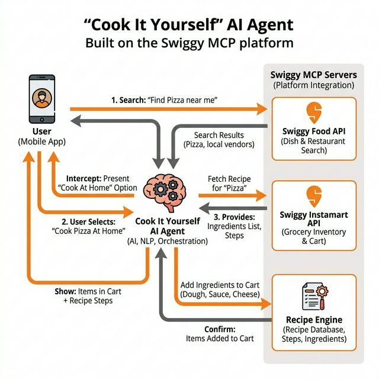

### Component Breakdown

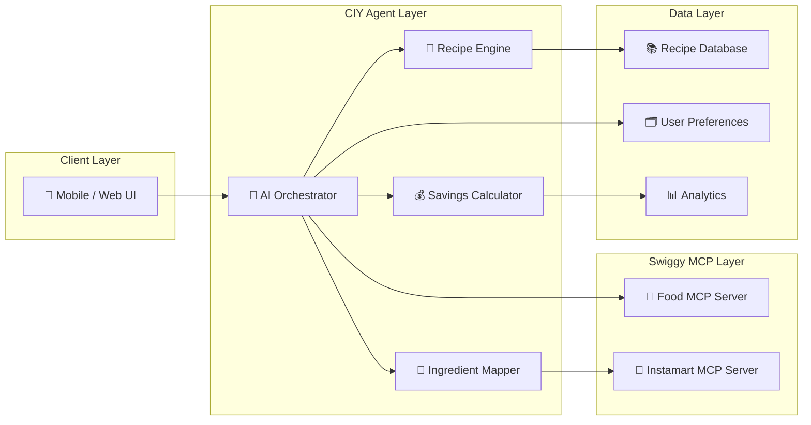

### Core Components

| Component | Responsibility | Technology |
|---|---|---|
| **AI Orchestrator** | Coordinates the entire flow — from dish detection to cart creation | Python / Node.js + LLM (GPT-4/Claude) |
| **Recipe Engine** | Stores and retrieves recipes, handles serving adjustments, dietary filters | PostgreSQL + Vector DB for semantic search |
| **Ingredient Mapper** | Maps recipe ingredients to real Instamart SKUs using fuzzy matching | NLP + Swiggy Instamart Search API |
| **Savings Calculator** | Compares restaurant prices vs. ingredient costs in real-time | Swiggy Food API + Instamart pricing |
| **User Preferences** | Tracks dietary preferences, favorite recipes, household inventory | Redis + PostgreSQL |

---

## 6. UI/UX Mockups

### Screen 1 — The Smart Popup

When the user searches for "Butter Chicken," the CIY agent triggers a beautiful glassmorphism popup:

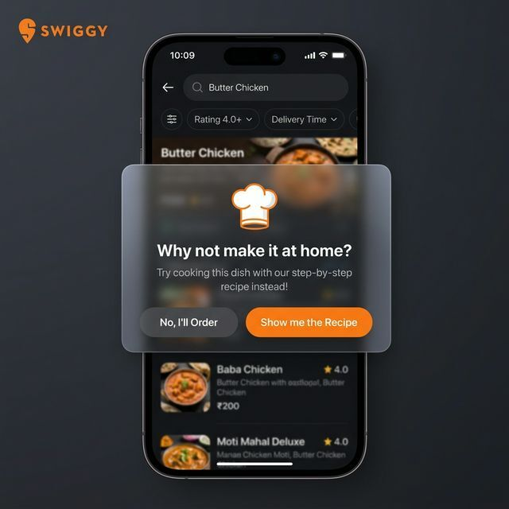

**Key Design Decisions:**
- Non-intrusive — overlays on top of existing search results
- Two clear CTAs: "Show me the Recipe" (primary) and "No, I'll Order" (secondary)
- Chef hat icon builds trust and sets cooking context
- Glassmorphism effect keeps the background visible, reducing jarring context switch

---

### Screen 2 — Recipe + Ingredients View

After the user taps "Show me the Recipe," they see the full recipe with interactive ingredient checkboxes:

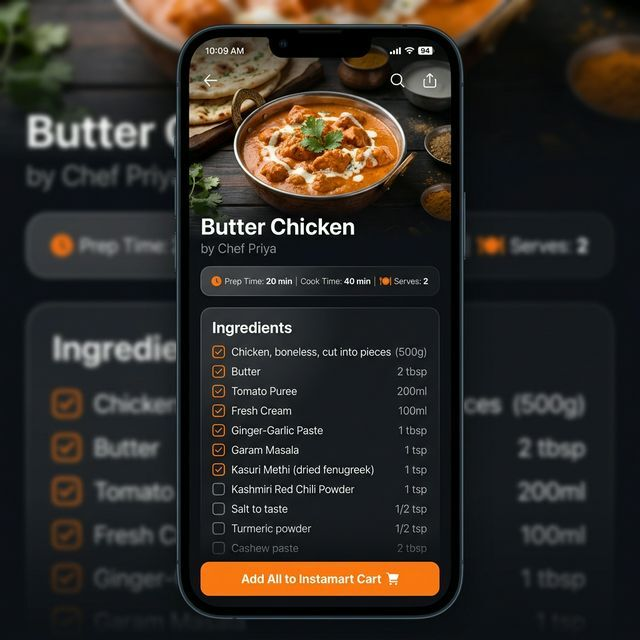

**Key Features:**
- Hero image of the finished dish for motivation
- Prep time, cook time, and servings displayed prominently
- Interactive ingredient checklist (uncheck items you already have)
- Prominent "Add All to Instamart Cart" CTA at the bottom
- Each ingredient shows exact quantity needed for the recipe

---

### Screen 3 — Instamart Cart (Auto-populated)

After tapping "Add All to Instamart Cart," the user is redirected to their Instamart cart with all ingredients pre-loaded:


**Key Features:**
- Savings banner at the top: "You saved ₹320 by cooking at home!"
- All ingredients mapped to real Instamart products with brand names
- Quantity adjustable with +/- controls
- Standard Instamart checkout flow — no extra steps needed
- Cart is labeled "Butter Chicken Essentials" for clear context

---

## 7. Swiggy MCP API Integration

### MCP Servers Used

This project leverages **two of Swiggy's three MCP servers**:

#### 🍔 Swiggy Food MCP Server

| API Function | Usage in CIY |
|---|---|
| **Search Restaurants** | Detect the dish being searched by the user |
| **Browse Menus** | Fetch restaurant prices for savings comparison |
| **Dish Details** | Get dish metadata (cuisine, dietary info, ratings) |

#### 🛒 Swiggy Instamart MCP Server

| API Function | Usage in CIY |
|---|---|
| **Search Products** | Find grocery items matching recipe ingredients |
| **Manage Cart** | Add/remove items, update quantities in user's cart |
| **Checkout** | Hand off the populated cart for standard Instamart checkout |
| **Track Delivery** | Show real-time delivery status of ingredients |

### Integration Flow (Technical)

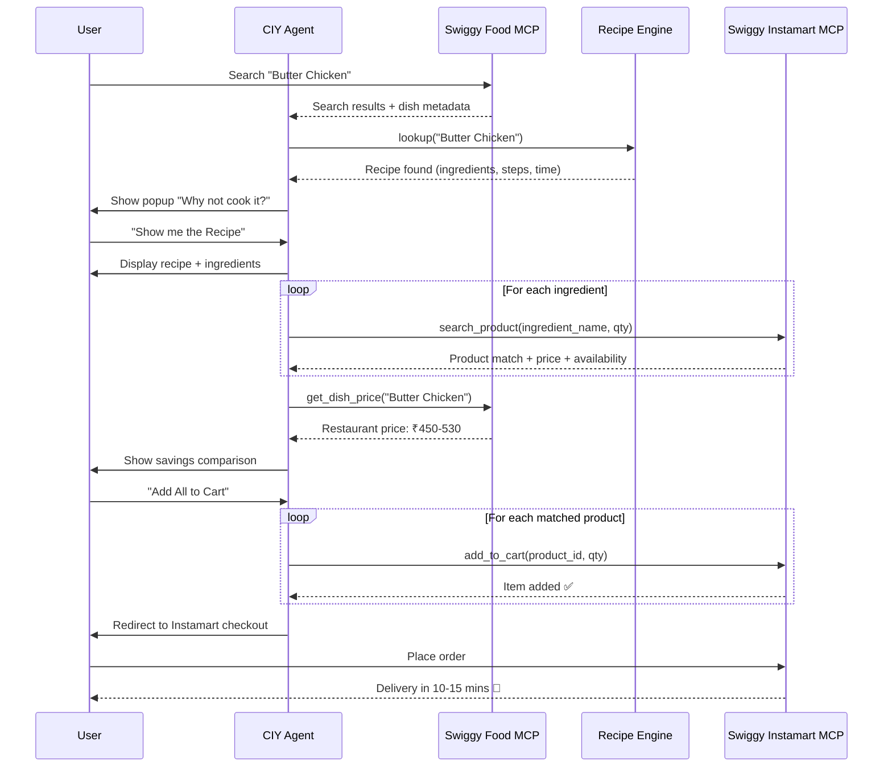

### AI Agent MCP Tool Calls (Sample)

Below is an example of the sequential MCP tool calls the AI agent makes:

```json
// Step 1: User searches on Swiggy Food
{
  "tool": "swiggy_food.search_restaurants",
  "params": {
    "query": "Butter Chicken",
    "lat": 28.6139,
    "lng": 77.2090
  }
}

// Step 2: Agent fetches recipe internally
{
  "tool": "recipe_engine.get_recipe",
  "params": {
    "dish_name": "Butter Chicken",
    "servings": 2,
    "diet": "non-veg"
  }
}

// Step 3: Map ingredients on Instamart
{
  "tool": "swiggy_instamart.search_products",
  "params": {
    "query": "Chicken Breast Boneless 500g",
    "category": "meat-fish"
  }
}

// Step 4: Add matched items to cart
{
  "tool": "swiggy_instamart.add_to_cart",
  "params": {
    "product_id": "instamart_sku_12345",
    "quantity": 1
  }
}

// Step 5: Calculate savings
{
  "tool": "swiggy_food.get_dish_price",
  "params": {
    "dish_name": "Butter Chicken",
    "restaurant_ids": ["rest_001", "rest_002", "rest_003"]
  }
}
```

---

## 8. Recipe Intelligence Engine

### How It Works

The Recipe Engine is the brain of CIY — it doesn't just store recipes; it **understands** food.

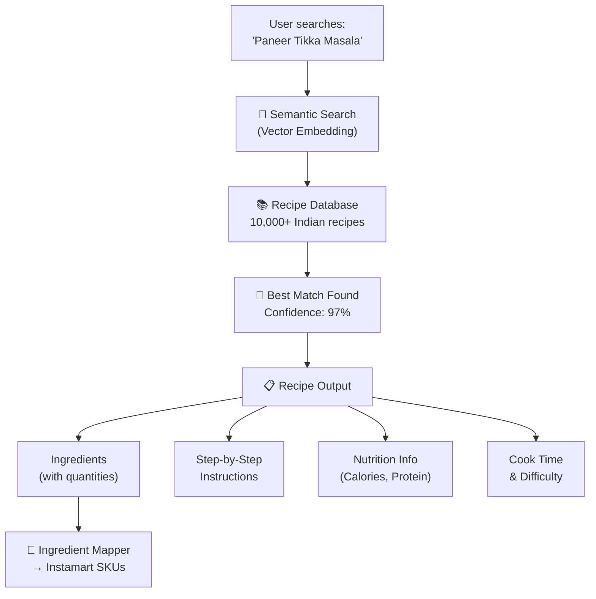

### Recipe Database Specs

| Attribute | Details |
|---|---|
| **Total Recipes** | 10,000+ (Phase 1: Top 500 dishes, expanding monthly) |
| **Cuisines** | North Indian, South Indian, Chinese-Indian, Continental, Street Food |
| **Data per Recipe** | Name, ingredients (with quantities), steps, prep/cook time, servings, nutrition, tags |
| **Dietary Tags** | Veg, Non-Veg, Egg, Vegan, Jain, Gluten-Free, Keto, High-Protein |
| **Sources** | Community-contributed, chef-verified, AI-generated + human-reviewed |

### Ingredient Mapping Logic

The mapper uses a **multi-step matching pipeline** to convert recipe ingredients into Instamart products:

```
Recipe Ingredient: "200ml Fresh Cream"
    ↓
Step 1: NLP Parsing → { item: "Fresh Cream", qty: 200, unit: "ml" }
    ↓
Step 2: Instamart Search → ["Amul Fresh Cream 200ml", "Mother Dairy Cream 250ml"]
    ↓
Step 3: Best Match → "Amul Fresh Cream 200ml" (exact quantity match, popular brand)
    ↓
Step 4: Availability Check → ✅ In stock, ₹48
    ↓
Step 5: Add to Cart → product_id: "INST_CREAM_001", qty: 1
```

### Smart Features

- **Pantry Awareness** — "Already have salt and oil at home? We won't add them."
- **Brand Preference** — Learns user preferences (e.g., always picks Amul over others)
- **Substitution** — If an ingredient is out of stock, suggests alternatives
- **Quantity Optimization** — Buys the smallest available pack that covers the recipe need

---

## 9. Cost Savings Analysis

### Butter Chicken: Restaurant vs. Home

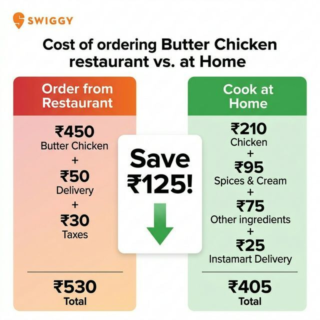

### Detailed Breakdown

| Item | Restaurant Order | Cook at Home (via Instamart) |
|---|---|---|
| Butter Chicken (dish) | ₹450 | — |
| Chicken (500g) | — | ₹210 |
| Butter (Amul, 100g) | — | ₹52 |
| Tomato Puree (Kissan) | — | ₹25 |
| Fresh Cream (Amul) | — | ₹48 |
| Ginger-Garlic Paste | — | ₹20 |
| Spices (Garam Masala, etc.) | — | ₹30 |
| Delivery Fee | ₹50 | ₹25 |
| Taxes & Charges | ₹30 | — |
| **Total** | **₹530** | **₹405** |
| **Savings** | — | **₹125 (24% saved)** |

> [!TIP]
> Spices, butter, and pantry items last multiple meals — the effective per-meal saving is even higher for repeat cooks. A user cooking 3x/week saves **₹1,500+/month.**

### Projected Savings Across Popular Dishes

| Dish | Avg. Restaurant Price | Instamart Ingredients | Savings |
|---|---|---|---|
| Butter Chicken | ₹530 | ₹405 | ₹125 (24%) |
| Paneer Tikka | ₹420 | ₹280 | ₹140 (33%) |
| Chole Bhature | ₹300 | ₹150 | ₹150 (50%) |
| Chicken Biryani | ₹450 | ₹320 | ₹130 (29%) |
| Dal Makhani | ₹350 | ₹160 | ₹190 (54%) |
| Pasta Alfredo | ₹380 | ₹250 | ₹130 (34%) |

---

## 10. Technical Requirements

### Application Architecture

| Layer | Technology | Purpose |
|---|---|---|
| **Frontend** | React Native / Flutter | Cross-platform mobile experience |
| **Backend** | Node.js / Python (FastAPI) | API orchestration, business logic |
| **AI/LLM** | GPT-4 / Claude API | Dish understanding, recipe generation, NLP |
| **Database** | PostgreSQL + Redis | Recipes, user prefs, caching |
| **Vector DB** | Pinecone / Weaviate | Semantic recipe search |
| **MCP Client** | Swiggy MCP SDK | Connection to Food + Instamart APIs |

### Infrastructure Requirements

| Requirement | Details |
|---|---|
| **Static IP** | Required for Swiggy MCP whitelisting |
| **Cloud Provider** | AWS / GCP (ap-south-1 for India latency) |
| **Auth** | OAuth 2.0 (Swiggy redirect URI integration) |
| **Rate Limits** | Default Swiggy MCP limits (expandable on request) |
| **Monitoring** | DataDog / Grafana for API health + latency |
| **Security** | TLS 1.3, encrypted at rest, no PII stored beyond session |

### MCP Access Requirements (for Swiggy Application)

| Field | Value |
|---|---|
| **Who** | Individual Developer / Startup Team |
| **What** | AI agent: recipe-to-Instamart-cart pipeline |
| **Architecture** | Client → CIY Backend → Swiggy Food MCP + Instamart MCP |
| **Redirect URI** | `https://cookityourself.app/auth/callback` |
| **Static IP** | To be provisioned upon acceptance |
| **Data Handling** | No PII stored. Session-only cart data. GDPR-compliant. |
| **Security Contact** | security@cookityourself.app |

---

## 11. Business Impact for Swiggy

### Why Swiggy Should Care

> [!IMPORTANT]
> CIY doesn't **reduce** Swiggy's revenue — it **redirects** a Food order into an **Instamart order**, which has **higher margins** and **higher retention**.

| Metric | Impact |
|---|---|
| **Instamart GMV** | ↑ Direct increase — every "Cook at Home" converts to Instamart order |
| **Instamart DAU** | ↑ New use case attracts users who never used Instamart before |
| **User Retention** | ↑ Cooking creates habit loops — users come back for more recipes |
| **Average Order Value** | ↑ Recipe-based carts are curated and complete (higher AOV than random grocery shopping) |
| **Brand Perception** | ↑ Swiggy becomes a "food lifestyle" platform, not just delivery |
| **Cross-selling** | ↑ Users discover Instamart through Food → long-term Instamart customers |

### Revenue Model

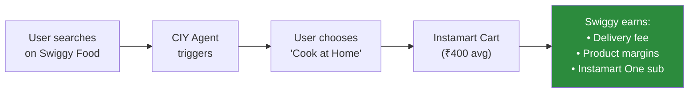

### Projected Impact (Conservative Estimates)

| Metric | Month 1 | Month 3 | Month 6 |
|---|---|---|---|
| Daily Active Users | 500 | 5,000 | 25,000 |
| Conversion Rate (popup → cart) | 8% | 12% | 15% |
| Avg. Instamart Order Value | ₹380 | ₹420 | ₹450 |
| Incremental Instamart GMV/day | ₹15,200 | ₹2,52,000 | ₹16,87,500 |
| Monthly Incremental GMV | ₹4.56L | ₹75.6L | ₹5.06 Cr |

---

## 12. Roadmap & Milestones

### Phase-wise Delivery

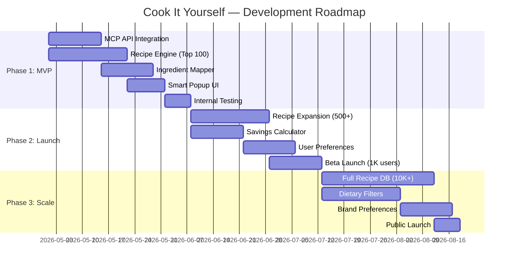

### Milestone Details

| Phase | Timeline | Deliverables |
|---|---|---|
| **Phase 1: MVP** | Week 1-6 | MCP integration, 100 recipes, ingredient mapper, popup UI, internal testing |
| **Phase 2: Launch** | Week 7-12 | 500+ recipes, savings calculator, user preferences, beta launch |
| **Phase 3: Scale** | Week 13-20 | 10K+ recipes, dietary filters, brand learning, public launch |
| **Phase 4: Ecosystem** | Week 21+ | Video recipe guides, chef collaborations, Swiggy One integration |

---

## 13. Security & Compliance

### Data Handling Policy

| Aspect | Policy |
|---|---|
| **User Data** | No PII stored beyond active session. Cart data is transient. |
| **API Keys** | Stored in secure vault (AWS Secrets Manager / HashiCorp Vault) |
| **Authentication** | OAuth 2.0 with Swiggy's redirect URI flow |
| **Encryption** | TLS 1.3 in transit, AES-256 at rest |
| **Logging** | Request/response logs (anonymized) for debugging, 30-day retention |
| **Compliance** | GDPR-ready, no data shared with third parties |
| **Access Control** | Role-based access, IP whitelisting for MCP endpoints |

### Swiggy Guidelines Compliance

> [!NOTE]
> This project fully complies with Swiggy MCP Builders Club ground rules:
> - ✅ Builds a tool that makes ordering/discovery **better** for users
> - ✅ AI-powered agent using MCP for commerce workflows
> - ✅ Follows Swiggy's security and branding guidelines ("Powered by Swiggy" badge)
> - ✅ No data scraping, reselling, or competitive benchmarking
> - ✅ No dark patterns or deceptive UX
> - ✅ Transparent pricing and availability (sourced directly from APIs)

---

## 14. Team & Contact

| Role | Details |
|---|---|
| **Builder** | Tanishq Bhatia |
| **Email** | builders@swiggy.in (for submission) |
| **MCP Servers** | Swiggy Food + Swiggy Instamart |
| **Apply Link** | [Swiggy Builders Club Application](https://forms.gle/4vkeKyqm15Qb6fnJA) |
| **Demo** | Will be shared upon MCP access approval |

---

## Appendix A: Additional Use Cases

Beyond the core "Cook It Yourself" flow, the MCP platform enables these extensions:

| Extension | Description | MCP Servers |
|---|---|---|
| **Meal Prep Planner** | Plan a week's meals, generate a single consolidated Instamart order for the entire week | Food + Instamart |
| **Party Mode** | Hosting a party? Pick dishes from restaurants, get all ingredients for 10+ servings | Food + Instamart |
| **Health Dashboard** | Compare nutrition: restaurant version vs. homemade version of the same dish | Food |
| **Leftover Chef** | Tell the agent what's in your fridge → it suggests recipes using those ingredients + orders the missing ones | Instamart |
| **Restaurant Copycat** | "Make Haldiram's Chole Bhature at home" — reverse-engineer popular restaurant dishes | Food + Instamart |
| **Dineout Integration** | Going to a restaurant tonight? CIY suggests: "Try making their signature dish at home tomorrow" | Dineout + Instamart |

---

## Appendix B: Competitive Landscape

| Feature | CIY (Cook It Yourself) | Meal Kit Services | Recipe Apps |
|---|---|---|---|
| Live dish search integration | ✅ (Swiggy Food) | ❌ | ❌ |
| Instant grocery delivery | ✅ (Instamart, 10 min) | ❌ (scheduled) | ❌ |
| Real-time price comparison | ✅ | ❌ | ❌ |
| One-tap cart population | ✅ | ✅ (fixed kits) | ❌ |
| Serving size flexibility | ✅ | Limited | ✅ |
| No subscription required | ✅ | ❌ (subscription) | ✅ |
| Brand/SKU awareness | ✅ (Instamart catalog) | ❌ | ❌ |

---

> **"Why order when you can cook? And why go to the store when Instamart delivers in 10 minutes?"**
> 
> — Cook It Yourself, Powered by Swiggy MCP 🍳

---

*Submitted to Swiggy Builders Club — April 2026*
*Contact: [builders@swiggy.in](mailto:builders@swiggy.in)*
